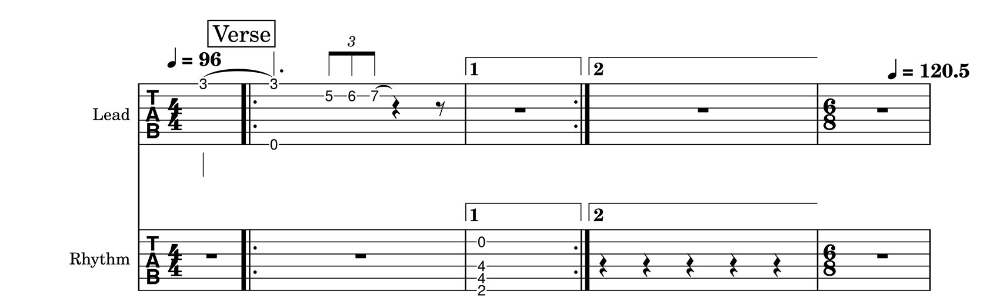
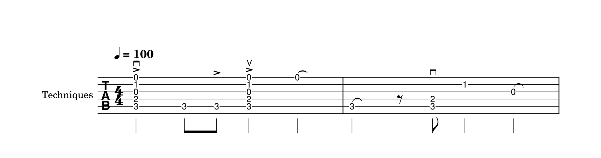

# MusicXML export: MuseScore check and export timing (ADR-033 E8 to E11)

Purpose: Record what MuseScore makes of our MusicXML export, and how long the export takes. This is evidence for [ADR-033](../docs/architecture/decisions/ADR-033-musicxml-export-adapter.md) section 4.
Scope: one machine (`reference-machine.md`, ADR-025) and one reader, MuseScore 4.7.5. Finale, Dorico and Guitar Pro were not checked. Layout quality was not judged.

## Procedure (reproducible)

```
cargo build --release -p mc-cli --locked
powershell -ExecutionPolicy Bypass -File tools/musescore-check/run.ps1
```

`run.ps1` does the following:
- It writes the E1 inputs with `mc-cli`: `feature_rich`, `reference(SMALL)`, `reference(TYPICAL)`, an empty document, and `feature_rich` re-imported from our own MIDI export.
- It has MuseScore convert each one headless to MIDI and to MusicXML (`MuseScore4.exe -o`).
- It compares the results with `tools/musescore-check/compare.py` (Python standard library):
  - MIDI notes as pitch, onset and length in quarter notes, with repeats as each file plays them.
  - String and fret per part and measure.
- It renders `feature_rich` to PNG.

The full output of the run on 2026-11-09 is in [musescore/summary-2026-11-09.txt](musescore/summary-2026-11-09.txt). The procedure ran twice with identical results.

## E8: MuseScore opens every file; same notes as our MIDI export

All 10 conversions (5 inputs, each to MIDI and to MusicXML) exited 0 and wrote their file.

| Score | Notes (ours / MuseScore) | Same pitch and onset | Same length | Length differs, rendering only | Real difference |
|---|---|---|---|---|---|
| `reference(TYPICAL)` | 9 856 / 9 856 | 9 856 | 9 376 | 480 let ring | 0 |
| `feature_rich` | 14 / 13 | 13 | 9 | 2 dead, 2 let ring | 1 |

Explanations:
- **MuseScore releases every note one tick early** (1/480 quarter). Such notes count as the same length.
- **Let ring.**
  - Our MIDI export plays a let-ring note to the end of its bar (ADR-024); MuseScore's MIDI export plays it for its written length.
  - The MusicXML carries let ring correctly: MuseScore read and re-wrote all 552 `<tied type="let-ring"/>` of TYPICAL (see E9).
  - This is a difference in how MIDI is rendered, not lost content.
- **Dead notes.** Our MIDI export plays them as 1/64 at velocity 40 (ADR-024). MuseScore plays them at full length and shows them as a fret number on TAB, not as X. The `<notehead>x</notehead>` survives MuseScore's own MusicXML export.
- **The one real difference** is in `feature_rich`: G4 (pitch 67) at onset 9 quarters.
  - The pickup bar ties G4 into the first bar of the repeated section.
  - On the second pass the previous bar is ending 1, which has no G4. Our playback therefore plays the note again; MuseScore does not play it on the second pass.
  - MusicXML has no way to say "tied on the first pass only": `<tie>` applies on every pass. The file states the score as written.
  - So this is a difference in how the reader handles a tie into a repeat. It is not an approximation that the report counts.

**E8 is not met as written.** The criterion asks for the same notes, including length, except in bars the report counts as approximated:
- Every note's pitch and onset match, except the one tie-into-repeat note.
- The length differences come from rendering (let ring, dead notes) and from MuseScore releasing one tick early. They are not losses in the file.

The criterion is not changed. The gap is recorded in ADR-033 section 6.

## E9: string and fret survive MuseScore's MusicXML re-export

| Input | Notes with string and fret | Measures that differ | Let ring (ours / MuseScore) |
|---|---|---|---|
| `reference(TYPICAL)` | 9 600 / 9 600 | 0 | 552 / 552 |
| from MIDI | 20 / 20 | 0 | 0 / 0 |
| `feature_rich` | 10 / 10 | 1 | 1 / 1 |

The difference is the drop-D chord of the "Rhythm" track, which has **capo 2**.
- We write:
  - the open-string tuning in `<staff-tuning>`
  - `<capo>2</capo>`
  - frets counted from the capo
  - the sounding pitch (open string + capo + fret)
- This follows the MusicXML 4.0 definition of `<capo>`, which raises the open strings of `<staff-tuning>`.
- MuseScore ignores `<capo>` on import. Its own issue tracker records this ([MuseScore: "[MusicXML] support capo element"](https://musescore.org/en/node/20513)). It then derives the frets from the pitch:
  - frets +2 on strings 6, 5 and 4
  - one note moved from string 3, fret 4, to the open string 2
- Its re-export has no `<capo>`.

The encoding is not changed to suit MuseScore, because that would misstate the score.

**E9: met for tracks without a capo. A track with a capo is re-fingered by MuseScore (a known limitation of MuseScore). This is an evidence gap.**

## E10: rendering



Reviewed on 2026-11-09. The rendering shows:
- Both tracks on TAB staves, with names.
- The pickup.
- The tie from the pickup into bar 1.
- The "Verse" marker and both tempo marks (96, and 120.5 in the 6/8 bar).
- The repeat barlines, endings 1 and 2, and the 6/8 change.
- The triplet bracket.
- The let-ring tie on fret 7.
- The rest that pads the short voice.
- The five quarters of the overfull bar, all kept.

No collision hides a note. Seen in the rendering, and both explained above: the capo chord is re-fingered (0-4-4-2), and the dead note shows as "0".

**E10: met.**

## E11: export time (release, reference machine, 2026-11-09)

`mc-cli export-musicxml` in release mode, 7 runs each, timing only the export:

| Score | Median | Max | Criterion |
|---|---|---|---|
| `reference(TYPICAL)` (4 tracks, 150 bars, 9 600 notes) | 6.3 ms | 8.7 ms | ≤ 200 ms |
| `reference(LARGE)` (20 tracks, 300 bars, 288 000 notes, a 100.2 MB file) | 154.9 ms | 164.7 ms | ≤ 2 s |

**E11: met** on this machine.

## ADR-035 TQ-8: playing techniques through MuseScore (6a-1, 2026-11-09)

The procedure now also exports the `techniques` fixture (ADR-035: every technique and combination, two bars of 4/4, open C shape). MuseScore converts it to MusicXML and to PNG, and `compare.py techniques` checks, note by note, which marks MuseScore's re-export still has. Full output: [musescore/summary-6a1-2026-11-09.txt](musescore/summary-6a1-2026-11-09.txt). In the same run, E8 and E9 gave exactly the results above.

MuseScore 4.7.5 opened the file and converted it (exit 0). All 19 notes and rests come back at the same place, string and fret.

| Technique (our encoding) | Ours | In MuseScore's re-export | Result |
|---|---|---|---|
| Accent (`<articulations><accent/>`) | 11 notes on 3 beats | 3: one per beat, on the chord's first note | Kept per beat. MuseScore stores articulations per chord, so a chord where only some notes are accented cannot be told apart from a fully accented one |
| Down-stroke (`<technical><down-bow/>`) on notes | 2 | 2 | Kept; drawn as the down-bow symbol |
| Down-stroke on a rest | 1 | 0 | **Lost** |
| Up-stroke (`<technical><up-bow/>`) | 1 | 1 | Kept; drawn as the up-bow symbol |
| `x` notehead (dead or string-percussive) | 7 | 7 | Kept in the file. On TAB MuseScore draws fret digits, not `x` (as for dead notes in E10) |
| Palm mute (`<other-technical>palm mute</other-technical>`) | 4 | 0 | **Lost**: not drawn, not re-exported |
| String-percussive (`<other-technical>string percussive</other-technical>`) | 6 | 0 | **Lost**: not drawn, not re-exported. The `x` notehead stays, so MuseScore sees it as a dead note |



The rendering shows the accents, the down-bow and up-bow symbols and the let-ring ties. It shows no palm-mute or string-percussive text and no mark on the rest.

**TQ-8: MuseScore opens the file, and the result for each technique is recorded. Palm mute, string-percussive and a stroke on a rest are lost in MuseScore. Per-note accents in a chord collapse to one accent per chord. This is an evidence gap, not a pass.** Our file follows MusicXML 4.0 (ADR-035 section 9), so the encoding is not changed to suit MuseScore.
