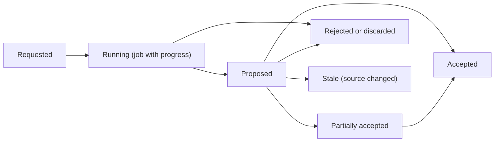

# AI and Music Intelligence Architecture

Purpose: Define how analysis and AI features extend the Music Core without becoming its authority: data layers, provenance, candidate lifecycle and deployment options.
Status: Proposed. No AI work before Phase 8. Model choices depend on S8 and S9.
Related documents: [feasibility-assessment.md](../research/feasibility-assessment.md), [domain-invariants.md](domain-invariants.md), [data-architecture.md](data-architecture.md), [security-and-privacy.md](security-and-privacy.md), [ADR-013](decisions/ADR-013-ai-provenance-candidate-layer.md).

## 1. Data layers

| Layer | Example | Mutability | Stored |
|---|---|---|---|
| L1 Original user data | Authored score, user recordings | User only | Project package |
| L2 Raw audio | Imported MP3, mic capture | Immutable once imported | Package assets or external reference with hash |
| L3 DSP analysis | Pitch track, onsets, chroma | Regenerable | Cache |
| L4 ML inference | Note probabilities, stems | Regenerable | Cache |
| L5 Candidate interpretations | Melody notes, chord progression, TAB proposal | Reviewable, discardable | Cache; optionally project `analysis/` |
| L6 User-confirmed data | Accepted candidate converted into score content | User data | Score (with provenance link) |

Flow is one-directional: L2 to L5 never write L1 or L6. Only an explicit user `AcceptCandidate` command (possibly partial: selected bars) converts L5 into normal score commands that pass full validation (AI-02, GR-04).

## 2. Provenance schema (Proposed)

```json
{
  "candidate_id": "01J...",
  "kind": "melody_transcription",
  "source": { "asset_id": "01J...", "sha256": "<hex>", "range_seconds": [0.0, 32.5] },
  "producer": { "type": "model", "id": "basic-pitch", "version": "0.x", "artifact_sha256": "<hex>", "runtime": "ort 2.x, cpu" },
  "parameters": { "onset_threshold": "0.5" },
  "confidence": { "overall": 0.72, "per_item": "optional array" },
  "created_at": "2027-01-01T00:00:00Z",
  "status": "proposed"
}
```

Parameters and confidence are recorded but not used as domain values; numeric floats are acceptable here because this is metadata, not music data. Accepted score content keeps a reference (`origin: candidate_id`) at the bar or track level so users can see what was AI-assisted.

## 3. Candidate lifecycle



- Jobs run off the command worker, report `JobProgress` events, and can be cancelled.
- Candidates never overwrite confirmed content. Accepting into a region that already has content requires an explicit choice (replace, merge into new track, cancel).
- A candidate becomes stale if the source asset hash or the target region revision changes.

## 4. Module placement

- Phase 8: a new `mc-analysis` crate depending on `mc-theory` and `mc-dsp` only. Produces `Candidate<T>` values.
- ML runtime adapter (Phase 9): `mc-ml` adapter crate wrapping ort or tract behind a `ModelRuntime` port defined in `mc-app`. Model files are downloaded or bundled per platform; never inside domain crates.
- Arrangement (Phase 10): starts with deterministic rule-based accompaniment (chord progression plus pattern engine) before any generative model.

## 5. Deployment options

| Option | Performance | Memory and GPU | Privacy | Cost | Platforms | Assessment |
|---|---|---|---|---|---|---|
| On-device mobile inference | Limited | Small models only; battery | Best | None | Android, iOS | Only light models (pitch, small chord models) |
| Local desktop inference | Good; GPU optional (DirectML, CoreML, CUDA via ort [To verify]) | Hundreds of MB to GBs for separation | Best | None | Windows, macOS, Linux | Default for heavy features |
| Optional remote inference (own service) | Best | Server side | Audio leaves device; needs consent | Hosting cost, operational burden | All | Deferred; only with explicit opt-in |
| External model providers (APIs) | Varies | Server side | Third-party processing terms | Per-use cost | All | Deferred; provider-neutral port if ever used |

Not all platforms run the same models: the capability matrix in [performance-requirements.md](performance-requirements.md) decides per platform which features are offered, and the UI hides or degrades unavailable ones.

## 6. Realism statements

- No single model reliably converts arbitrary polyphonic audio into accurate guitar TAB ([feasibility-assessment.md](../research/feasibility-assessment.md)).
- Practical pipeline: separation (optional) to pitch and onset candidates to deterministic playability optimization to TAB candidate for user editing.
- Model and weight licenses are checked per model (S7, S9) before distribution.
