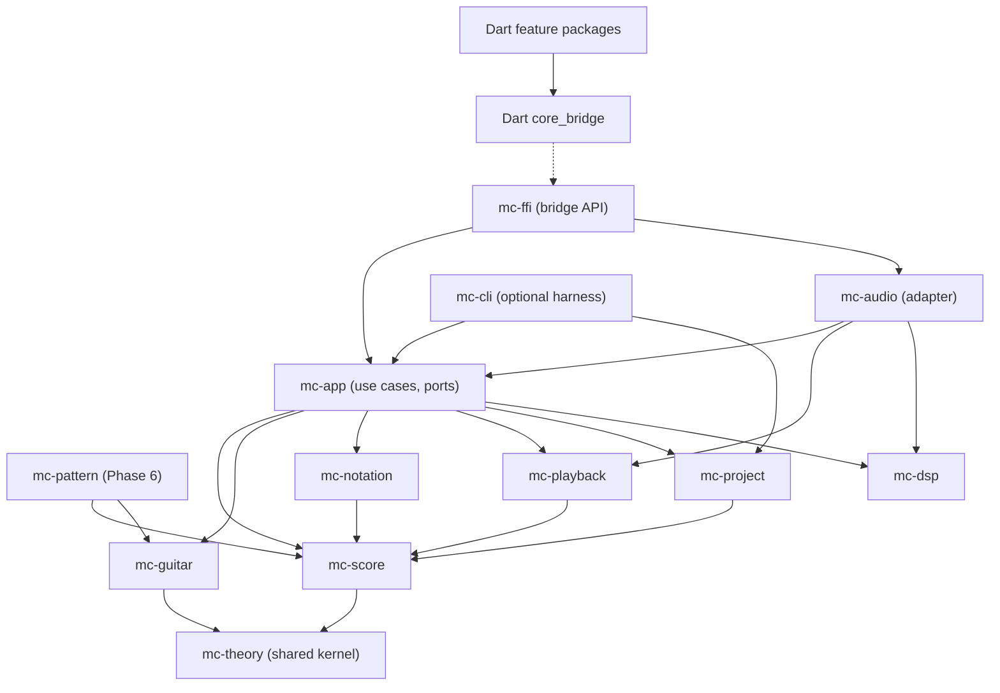
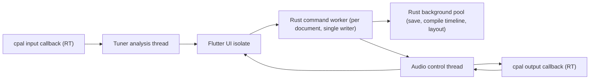

# Architecture Overview

Purpose: Describe the architecture style, the Rust crate DAG with its introduction schedule, the Dart package structure, and the runtime thread view.
Status: Accepted.
Related documents: [system-context.md](system-context.md), [domain-map.md](domain-map.md), [dependency-rules.md](dependency-rules.md), [interop-architecture.md](interop-architecture.md), [audio-dsp-architecture.md](audio-dsp-architecture.md), [ADR-001](decisions/ADR-001-modular-monolith.md), [ADR-003](decisions/ADR-003-context-map-and-crate-dag.md).

## 1. Style

- Modular monolith: one process, one Rust Cargo workspace (the Music Core) and one Flutter app with a small Dart package workspace.
- Rust is the single source of truth for music data ([ADR-002](decisions/ADR-002-rust-core-source-of-truth.md)). Dart holds opaque document handles, sends commands and renders read projections.
- Hexagonal layering inside Rust: pure domain crates, an application crate `mc-app` that defines ports (`ProjectStore`, `AudioPort`, `Clock`, `EventSink`), and adapter crates that implement ports. Composition happens in `mc-ffi` (app) and `mc-cli` (harness).
- Crates are introduced only in the phase that needs them. No empty crates.

## 2. Rust crate DAG

Arrows point from dependent to dependency. Every domain crate may also depend directly on `mc-theory`; those edges are omitted except where they are the only dependency.



From Phase 6, `mc-project` and `mc-app` also depend on `mc-pattern`. There is no edge from `mc-score` to `mc-guitar` ([ADR-019](decisions/ADR-019-fretted-instrument-shared-kernel.md)). The dashed edge is the generated FFI boundary, not a Cargo dependency.

`mc-audio` depends on `mc-app` to implement the `AudioPort` trait defined there. If that edge proves awkward (for example, `mc-cli` wanting audio without the app), the port traits move to a tiny `mc-ports` crate. That is a recorded option, not planned work.

### Crate responsibilities and introduction schedule

| Crate | Layer | Introduced | Responsibility | Allowed external deps (initial) |
|---|---|---|---|---|
| `mc-theory` | Domain (kernel) | Phase 1 | Value objects, pure arithmetic | none |
| `mc-score` | Domain (core) | Phase 1 | Score aggregate, diagnostics | none |
| `mc-project` | Domain service (persistence format) | Phase 1 | DTOs, migration, package read and write on byte streams | serde, serde_json, zip, sha2 |
| `mc-app` | Application | Phase 1 | Sessions, dispatcher, handlers, undo, ports, events; re-exports types needed by `mc-ffi`; file-system `ProjectStore` adapter (atomic save, autosave, recovery) in module `infra::fs_store` behind cargo feature `native-fs` | thiserror, tracing, tempfile (feature `native-fs`) |
| `mc-cli` | Adapter (harness) | Phase 1 | Command-line harness for tests and debugging without UI | clap, file system |
| `mc-guitar` | Domain (supporting) | Phase 2 | Fretboard, chord finder, voicings | none |
| `mc-notation` | Projection | Phase 3 | TAB layout display list | none |
| `mc-ffi` | Adapter (interop, composition root) | Phase 3 | frb API, DTO mapping, streams | flutter_rust_bridge |
| `mc-playback` | Domain service (pure) | Phase 4 | Score to PerformanceTimeline, MIDI mapping | midly (in adapter module) |
| `mc-audio` | Adapter (RT) | Phase 4 | cpal streams, synth, RT queues, tuner thread; small Windows-only module for callback thread priority (MMCSS) | cpal (without `realtime`), rustysynth, rtrb, windows-sys (Windows only) |
| `mc-dsp` | Generic (pure) | Phase 5 | YIN/MPM, FFT wrappers | realfft or rustfft |
| `mc-pattern` | Domain (supporting) | Phase 6a | Pattern IR and binding | none |

MVP crate count: 11. Mitigation for solo-developer overhead: one workspace, shared lint and CI configuration, crates added only when needed. If any crate stays under about 300 lines at Phase 5 end, merging it is reviewed (see review findings in [architecture/README.md](README.md)).

## 3. Dart package structure (Phase 3)

```text
app/                       Flutter application (composition, routing, theming)
packages/
  core_bridge/             Generated frb bindings (lib/src/generated, private) + DocumentService facade + fakes
  editor_feature/          TAB editor UI: canvas painter, cursor, selection, input
  tools_feature/           Tuner, chord finder, fretboard
  playback_feature/        Transport controls
  platform/                dart:io, file pickers, permissions, window management
  ui_kit/                  Shared widgets and theme
```

Rules: feature packages import only the `core_bridge` public facade, `ui_kit` and `platform`; they never import generated bindings (FF-05). Features do not import each other; cross-feature navigation is done in `app/`. This structure is the plan for Phase 3; packages are created when their first code is written.

## 4. Runtime view (desktop)



- Dart calls into Rust asynchronously; frb runs them on its worker pool. Document commands are serialized by the session (single writer).
- RT threads never call into Dart or block. See [audio-dsp-architecture.md](audio-dsp-architecture.md).

## 5. What this architecture accommodates and what it does not

Accommodates without structural change: new commands and projections, new import and export adapters, new non-fretted instruments as `InstrumentSpec` and `NoteValue` variants, analysis features producing candidates, a CLI, WASM builds of domain crates, replacing frb, replacing the synth.

Requires reconsideration (ADR): real-time collaboration, polymeter, audio tracks with editing, plugin hosting, out-of-process ML runtimes, multi-document linked parts.
