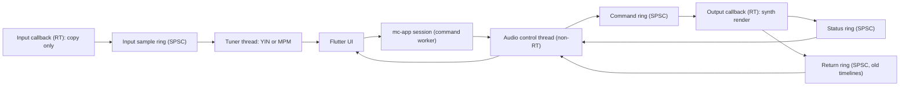

# Audio and DSP Architecture

Purpose: Define the real-time audio design (control plane vs data plane, threads, buffers, timeline swapping, tuner) and separate verified library capabilities from implementation assumptions that Phase 0 spikes must validate.
Status: Playback design Accepted after S2 (A1 to A3 and A5 to A7 pass; A4 partially met). Tuner design (A8 to A10) Proposed until S3 in Phase 5. Using cpal, rustysynth and rtrb does not by itself guarantee real-time safety; S2 showed that thread priority promotion is also required.
Related documents: [architecture-overview.md](architecture-overview.md), [interop-architecture.md](interop-architecture.md), [performance-requirements.md](performance-requirements.md), [ADR-007](decisions/ADR-007-audio-thread-isolation.md), [technical-spikes.md](../research/technical-spikes.md), [technology-evaluation.md](../research/technology-evaluation.md).

## 1. Threads and planes

- Control plane (low rate): play, stop, seek, tempo factor, load timeline, load SoundFont. Status out: position, state, underrun counters.
- Data plane (RT): the output callback renders audio from a preallocated synth and an event cursor; the input callback only copies samples into a ring.
- The control thread owns lifecycle: device open and close, stream rebuild on device change, SoundFont loading, timeline compilation scheduling, freeing old objects.

## 2. Real-time rules (GR-10)

Inside RT callbacks:

- No allocation or deallocation, no locks (`Mutex`, `RwLock`, channel types that may block), no I/O, no logging or formatting, no syscalls that may block, no FFI calls into Dart.
- Only wait-free ring operations, preallocated buffers, and atomics.
- Bounded work per callback: messages processed per callback are capped.
- Panics are caught at the callback boundary; on panic the callback outputs silence and sets an error flag [Proposed; unwinding across the cpal callback was not tested in S2, check in Phase 4].
- The callback thread is promoted to real-time scheduling on its first invocation (Windows: MMCSS task "Audio"; see [ADR-007](decisions/ADR-007-audio-thread-isolation.md)). The one-time promotion call uses a preallocated task name and does not allocate.
- Underruns are detected from callback timing (interval against reported output latency), because cpal reports no xruns on WASAPI shared render.

Enforcement:

- FF-16: tests and debug builds wrap the callback body with `assert_no_alloc` (detects allocation only).
- FF-17: lint script over `mc-audio/src/rt/` rejecting `Mutex`, `RwLock`, `println!`, `format!`, `vec!`, `Vec::push`, `Box::new`, `String`, `std::fs`, `tracing` macros. Lock detection is not automatic beyond this; review checklist covers the rest.
- FF-18: glitch test (S2-derived) in a scheduled job on a real Windows machine.

## 3. Playback design

1. On transport play or score change, the control thread asks `mc-app` for a snapshot and compiles a `PerformanceTimeline` (sorted tick events, tempo map to sample conversion table) on a background thread.
2. The compiled timeline is boxed and sent through the command ring.
3. The callback swaps its current timeline pointer, relocates the cursor by binary search on the current tick (no allocation), and sends the old box through the return ring.
4. The control thread drops old timelines off the RT thread.
5. Tempo control in MVP is a playback-rate factor applied to the tick-to-sample conversion; changing it sends a scalar, not a new timeline.
6. Synth renders at the device sample rate; no sample-rate conversion in MVP.
7. Stop and seek send all-notes-off to the synth inside the callback.

Score edits during playback: recompile and swap; continuity is checked by A6.

## 3a. Timeline semantics (deterministic)

`compile(snapshot, options) -> PerformanceTimeline` in `mc-playback` is a pure function: the same snapshot and options always produce an identical timeline (PB-09). No clocks, randomness or hash-map iteration order are involved.

1. Playback order: master bars are expanded by repeats and alternate endings into a sequence of bar indices. A repeat without an explicit count plays twice. Expansion is capped at 10 000 played bars; beyond the cap compilation stops and returns a `PlaybackWarning`.
2. Bar timing: each played bar starts at `start(k)` and lasts `E(m)` as defined in [domain-invariants.md](domain-invariants.md) section 4a. All tracks share these start times. Muted tracks contribute to `E(m)`; mute is applied by omitting their note events, not by changing timing.
3. Ticks: score positions are rationals of a whole note. The timeline uses an integer `ticks_per_whole` equal to the least common multiple of all denominators of positions and durations in the snapshot. If that exceeds 2^20, it falls back to 215 040 (2^11 x 3 x 5 x 7, which is exact for base values down to 1/256 with up to three dots, combined with triplet, sextuplet, quintuplet and septuplet ratios; other tuplets such as 9:8 are rounded) and positions are rounded down to the nearest tick, with a `PlaybackWarning` listing the affected bars. Ticks are `i64`.
4. Note events: note on at `start(k) + beat onset`. Note off at the end of the beat duration, extended across tie chains to the end of the last tied note. Let ring (when supported) extends the note off to the next onset on the same string in the same track, or to the end of the played bar, whichever comes first.
5. Same-tick ordering: note off, then tempo, then program change, then note on. Ties within a category are ordered by track index, then voice index, then string index.
6. Tempo: tempo map entries are converted to ticks. Seconds are derived by piecewise integration over tempo segments. The user tempo factor scales all tempos uniformly. Tick to sample conversion uses integer arithmetic (`u128` intermediates) with rounding down, so sample positions are reproducible on every platform.
7. Pitch: sounding pitch comes from tuning, capo and fret. Pitches outside MIDI 0 to 127 are omitted with D-05 warnings.
8. Fixed values ([ADR-024](decisions/ADR-024-playback-rendering-conventions-and-rt-failures.md)): velocity 96 for every note; dead notes velocity 40 and a note off after exactly 1/64 of a whole note (or at the end of a shorter beat), outside tie chains and without let ring (so 64 is always among the tick denominators of rule 3); let ring as in rule 4, taken from the first note of a tie chain; a note on that hits a key already sounding on its channel first ends the earlier note at the same tick; channels 0 to 8 and 10 to 15 in score order, General MIDI program 25 (Acoustic Guitar (steel)) on every channel at tick 0.

Tests: PB-09 (determinism), timeline variants of PB-02, PB-04 and PB-07, a golden timeline for the reference scores, and a property test that every note on has exactly one later or equal note off on the same channel and key. All are Phase 4 `mc-playback` tests; the bar timing rules they depend on are tested in Phase 1 (PB-01 to PB-08).

## 3b. Implementation status of the playback engine (slice 4b)

`mc-audio` implements sections 1 to 3 and 6. Where it is and how it is checked:

| Part | Where | Check |
|---|---|---|
| Callback core (events applied sample-accurately by splitting blocks, seek, stop, tempo factor re-anchored at the same tick, timeline and synth swap, silence on panic) | `crates/mc-audio/src/rt/` | unit tests (buffer-size independence, determinism, swap, panic path); FF-16 `tests/no_alloc.rs` with a negative control; FF-17 `cargo xtask fitness rt-scan` |
| Control thread (SoundFont loaded lazily at the first Play, warm-up before install, rings, freeing retired objects, stream rebuild after a device error) | `control.rs`, `device.rs`, `soundfont.rs` | `tests/device.rs` (ignored without a device; run on the reference machine) |
| Offline engine (same core, no device) | `offline.rs` | used by the tests above |
| Tick to sample conversion integrates every tempo segment | `mc-playback` `PerformanceTimeline::tick_to_sample` | `tempo_changes_are_integrated_piecewise` |

Measured on the reference machine (evidence for that machine only, ADR-025): 48 kHz shared mode, 0 late callbacks in 2 s, longest callback 3.45 ms, reported output latency 32.9 ms.

Windows MMCSS promotion of the callback thread (ADR-007 amendment 1) is implemented in `crates/mc-audio/src/mmcss.rs` under the reviewed `unsafe` exception of [ADR-027](decisions/ADR-027-unsafe-exception-mmcss-module.md). The status reports `Promotion::Promoted`, or `Promotion::Unavailable` if the OS call fails (the callback then runs at normal priority; S2 saw late callbacks of up to 37 ms in that case). Other platforms report `NotNeeded`.

## 4. Tuner design

- Input callback copies frames (mono mix) into a preallocated SPSC ring. Nothing else.
- Tuner thread reads windows (default 2048 samples at 48 kHz, hop 512) and runs YIN or MPM from `mc-dsp` with preallocated buffers.
- Output: Hz, nearest note in the active tuning, cents, clarity, coalesced to 20 to 30 Hz for the UI.
- Low E (82.4 Hz) has a period of about 12 ms; a 2048-sample window at 48 kHz (about 43 ms) holds about 3.5 periods, which is sufficient for YIN [Assumption, A8 and A9].

## 5. Verified capabilities vs assumptions

Verified (from READMEs and registry metadata, see [technology-evaluation.md](../research/technology-evaluation.md)):

| Library | Verified capability |
|---|---|
| cpal | Callback-based input and output streams; WASAPI default on Windows (Windows 10+), optional ASIO; CoreAudio, ALSA, AAudio, Web Audio backends; buffer size query; optional `realtime` priority feature |
| rustysynth | SoundFont synthesis in real time and offline; reverb and chorus; MIDI sequencer; no dependencies beyond std |
| rtrb | Real-time-safe wait-free SPSC ring buffer, MIT OR Apache-2.0, maintained (release 2026-10) |
| assert_no_alloc | Aborts or warns on allocation in marked scopes; disabled in release by default |

Assumptions and their M0 status (measured values in [technical-spikes.md](../research/technical-spikes.md) S2 results): A1, A2, A3, A5, A6 and A7 pass; A4 is partially met (priority promotion required, rare OS stalls up to 44 ms remain); A8 to A10 are untested until S3.

| Id | Assumption | Spike | Measurable criterion |
|---|---|---|---|
| A1 | rustysynth `render`, `note_on`, `note_off` do not allocate or lock after construction | S2 | assert_no_alloc passes over 10 min playback of the reference score including program changes |
| A2 | The cpal WASAPI path does not block our callback beyond the buffer period | S2 | Callback p99 duration under 50 percent of buffer period |
| A3 | rtrb push and pop do not allocate | S2 | assert_no_alloc passes |
| A4 | No underruns during 10 min playback under concurrent CPU load (S2 simulates UI load with busy threads; the real UI load case is repeated in Phase 4 with FF-18) | S2 | Zero gaps detected via callback timestamp deltas and stream error callbacks |
| A5 | WASAPI shared-mode output latency is acceptable; whether cpal exposes exclusive mode or honors `BufferSize::Fixed` on WASAPI is unknown | S2 | Playback start under 100 ms perceived; output latency measured and recorded on reference machine |
| A6 | Timeline swap during playback causes no glitch, no allocation in callback and correct cursor continuity | S2 | 100 swaps during playback: zero gaps, cursor tick monotonic, assert_no_alloc passes |
| A7 | Rendering at device rate handles 44.1 and 48 kHz devices | S2 | Correct pitch (A4 renders 440 Hz within 1 cent) at both rates |
| A8 | Tuner end-to-end latency (sound to UI) at most about 100 ms | S3 | Measured with a click and timestamp test |
| A9 | YIN or MPM accuracy within plus or minus 2 cents steady state on recorded guitar strings, stable on low E | S3 | Test recordings of all six open strings; octave-error rate recorded |
| A10 | Microphone permission denial and device-busy cases produce typed errors, not crashes, on Windows | S3 | Manual test with privacy setting off and device in exclusive use |

If A1 fails: preallocate voices via settings, patch or fork rustysynth, or replace the synth behind the `Synth` trait. If A2, A4 or A5 fail: evaluate cpal `realtime` feature, larger buffers, or ASIO (developer-only).

## 6. Resource ownership and lifecycle

- `AudioEngine` (in `mc-audio`) owns cpal streams, ring endpoints and the control thread. Created by the composition root in `mc-ffi`, exposed as an opaque `EngineHandle`.
- Dropping the handle stops streams, joins the control thread, and frees timelines.
- Device change or disconnect: cpal error callback sets a flag; control thread rebuilds the stream and emits `AudioDeviceChanged`.
- SoundFont: loaded on the control thread into an `Arc`; a new synth is constructed off-thread and swapped like a timeline.

## 7. Deterministic DSP vs ML

| Capability | Approach | Class |
|---|---|---|
| Tuner pitch | YIN or MPM | Deterministic |
| Onset detection | Spectral flux | Deterministic |
| Tempo estimation | Onset autocorrelation or tempogram | Deterministic |
| Key from notes | Profile correlation | Deterministic |
| Vocal pitch tracking | pYIN (deterministic) or CREPE (ML) | Deterministic first |
| Chord recognition from audio | Chroma template (baseline) or ML | ML for useful accuracy |
| Polyphonic transcription | Basic Pitch class models | ML |
| Source separation | Demucs class models | ML |

## 8. Platform notes

- Windows (MVP): WASAPI shared mode. On the reference machine the period is fixed at 480 frames (10 ms) at 48 kHz and `BufferSize::Fixed` is not honored [Verified: S2]. Reported output latency was 33 to 53 ms. ASIO only as optional developer feature (requires ASIO SDK and drivers; licensing of the ASIO SDK [To verify]).
- macOS: CoreAudio; cpal README lists macOS 14.2 minimum [Verified: README], which may constrain supported macOS versions [To verify impact].
- Linux: ALSA dev libs required at build time; PipeWire optional.
- Android: AAudio (API 26+). iOS: AVAudioSession configuration needed outside cpal [Assumption]; S12.
- Web: AudioWorklet backend needs nightly and cross-origin isolation; not an MVP target.
