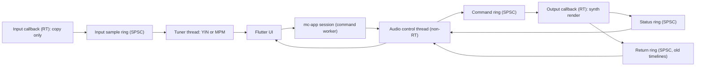

# Audio and DSP Architecture

Purpose: Define the real-time audio design (control plane vs data plane, threads, buffers, timeline swapping, tuner) and separate verified library capabilities from implementation assumptions that Phase 0 spikes must validate.
Status: Proposed. Becomes Accepted when S2 and S3 pass. Using cpal, rustysynth and rtrb does not by itself guarantee real-time safety.
Related documents: [architecture-overview.md](architecture-overview.md), [interop-architecture.md](interop-architecture.md), [performance-requirements.md](performance-requirements.md), [ADR-007](decisions/ADR-007-audio-thread-isolation.md), [technical-spikes.md](../research/technical-spikes.md), [technology-evaluation.md](../research/technology-evaluation.md).

## 1. Threads and planes

- Control plane (low rate): play, stop, seek, tempo factor, load timeline, load SoundFont. Status out: position, state, underrun counters.
- Data plane (RT): the output callback renders audio from a preallocated synth and an event cursor; the input callback only copies samples into a ring.
- The control thread owns lifecycle: device open and close, stream rebuild on device change, SoundFont loading, timeline compilation scheduling, freeing old objects.

## 2. Real-time rules (GR-10)

Inside RT callbacks:

- No allocation or deallocation, no locks (`Mutex`, `RwLock`, channel types that may block), no I/O, no logging or formatting, no syscalls that may block, no FFI calls into Dart.
- Only wait-free ring operations, preallocated buffers, and atomics.
- Bounded work per callback: messages processed per callback are capped.
- Panics are caught at the callback boundary; on panic the callback outputs silence and sets an error flag [Proposed; behaviour of unwinding across cpal callback to be checked in S2].

Enforcement:

- FF-16: tests and debug builds wrap the callback body with `assert_no_alloc` (detects allocation only).
- FF-17: lint script over `mc-audio/src/rt/` rejecting `Mutex`, `RwLock`, `println!`, `format!`, `vec!`, `Vec::push`, `Box::new`, `String`, `std::fs`, `tracing` macros. Lock detection is not automatic beyond this; review checklist covers the rest.
- FF-18: glitch test (S2-derived) in a scheduled job on a real Windows machine.

## 3. Playback design

1. On transport play or score change, the control thread asks `mc-app` for a snapshot and compiles a `PerformanceTimeline` (sorted tick events, tempo map to sample conversion table) on a background thread.
2. The compiled timeline is boxed and sent through the command ring.
3. The callback swaps its current timeline pointer, relocates the cursor by binary search on the current tick (no allocation), and sends the old box through the return ring.
4. The control thread drops old timelines off the RT thread.
5. Tempo control in MVP is a playback-rate factor applied to the tick-to-sample conversion; changing it sends a scalar, not a new timeline.
6. Synth renders at the device sample rate; no sample-rate conversion in MVP.
7. Stop and seek send all-notes-off to the synth inside the callback.

Score edits during playback: recompile and swap; continuity is checked by A6.

## 4. Tuner design

- Input callback copies frames (mono mix) into a preallocated SPSC ring. Nothing else.
- Tuner thread reads windows (default 2048 samples at 48 kHz, hop 512) and runs YIN or MPM from `mc-dsp` with preallocated buffers.
- Output: Hz, nearest note in the active tuning, cents, clarity, coalesced to 20 to 30 Hz for the UI.
- Low E (82.4 Hz) has a period of about 12 ms; a 2048-sample window at 48 kHz (about 43 ms) holds about 3.5 periods, which is sufficient for YIN [Assumption, A8 and A9].

## 5. Verified capabilities vs assumptions

Verified (from READMEs and registry metadata, see [technology-evaluation.md](../research/technology-evaluation.md)):

| Library | Verified capability |
|---|---|
| cpal | Callback-based input and output streams; WASAPI default on Windows (Windows 10+), optional ASIO; CoreAudio, ALSA, AAudio, Web Audio backends; buffer size query; optional `realtime` priority feature |
| rustysynth | SoundFont synthesis in real time and offline; reverb and chorus; MIDI sequencer; no dependencies beyond std |
| rtrb | Real-time-safe wait-free SPSC ring buffer, MIT OR Apache-2.0, maintained (release 2026-10) |
| assert_no_alloc | Aborts or warns on allocation in marked scopes; disabled in release by default |

Assumptions that must be validated (none are verified):

| Id | Assumption | Spike | Measurable criterion |
|---|---|---|---|
| A1 | rustysynth `render`, `note_on`, `note_off` do not allocate or lock after construction | S2 | assert_no_alloc passes over 10 min playback of the reference score including program changes |
| A2 | The cpal WASAPI path does not block our callback beyond the buffer period | S2 | Callback p99 duration under 50 percent of buffer period |
| A3 | rtrb push and pop do not allocate | S2 | assert_no_alloc passes |
| A4 | No underruns during 10 min playback while the UI scrolls a large score | S2 | Zero gaps detected via callback timestamp deltas and stream error callbacks |
| A5 | WASAPI shared-mode output latency is acceptable; whether cpal exposes exclusive mode or honors `BufferSize::Fixed` on WASAPI is unknown | S2 | Playback start under 100 ms perceived; output latency measured and recorded on reference machine |
| A6 | Timeline swap during playback causes no glitch, no allocation in callback and correct cursor continuity | S2 | 100 swaps during playback: zero gaps, cursor tick monotonic, assert_no_alloc passes |
| A7 | Rendering at device rate handles 44.1 and 48 kHz devices | S2 | Correct pitch (A4 renders 440 Hz within 1 cent) at both rates |
| A8 | Tuner end-to-end latency (sound to UI) at most about 100 ms | S3 | Measured with a click and timestamp test |
| A9 | YIN or MPM accuracy within plus or minus 2 cents steady state on recorded guitar strings, stable on low E | S3 | Test recordings of all six open strings; octave-error rate recorded |
| A10 | Microphone permission denial and device-busy cases produce typed errors, not crashes, on Windows | S3 | Manual test with privacy setting off and device in exclusive use |

If A1 fails: preallocate voices via settings, patch or fork rustysynth, or replace the synth behind the `Synth` trait. If A2, A4 or A5 fail: evaluate cpal `realtime` feature, larger buffers, or ASIO (developer-only).

## 6. Resource ownership and lifecycle

- `AudioEngine` (in `mc-audio`) owns cpal streams, ring endpoints and the control thread. Created by the composition root in `mc-ffi`, exposed as an opaque `EngineHandle`.
- Dropping the handle stops streams, joins the control thread, and frees timelines.
- Device change or disconnect: cpal error callback sets a flag; control thread rebuilds the stream and emits `AudioDeviceChanged`.
- SoundFont: loaded on the control thread into an `Arc`; a new synth is constructed off-thread and swapped like a timeline.

## 7. Deterministic DSP vs ML

| Capability | Approach | Class |
|---|---|---|
| Tuner pitch | YIN or MPM | Deterministic |
| Onset detection | Spectral flux | Deterministic |
| Tempo estimation | Onset autocorrelation or tempogram | Deterministic |
| Key from notes | Profile correlation | Deterministic |
| Vocal pitch tracking | pYIN (deterministic) or CREPE (ML) | Deterministic first |
| Chord recognition from audio | Chroma template (baseline) or ML | ML for useful accuracy |
| Polyphonic transcription | Basic Pitch class models | ML |
| Source separation | Demucs class models | ML |

## 8. Platform notes

- Windows (MVP): WASAPI shared mode. ASIO only as optional developer feature (requires ASIO SDK and drivers; licensing of the ASIO SDK [To verify]).
- macOS: CoreAudio; cpal README lists macOS 14.2 minimum [Verified: README], which may constrain supported macOS versions [To verify impact].
- Linux: ALSA dev libs required at build time; PipeWire optional.
- Android: AAudio (API 26+). iOS: AVAudioSession configuration needed outside cpal [Assumption]; S12.
- Web: AudioWorklet backend needs nightly and cross-origin isolation; not an MVP target.
