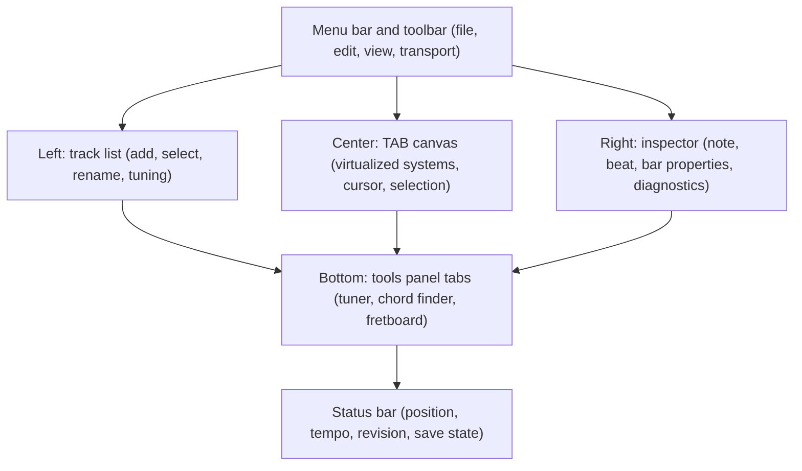

# Cross-Platform UI Architecture

Purpose: Define the adaptive Flutter UI: experiences per device class, desktop MVP layout, state ownership, input, rendering, accessibility.
Status: Accepted (principles, desktop MVP layout). State management library: Deferred to Phase 3 start. Mobile and tablet layouts: Proposed.
Related documents: [interop-architecture.md](interop-architecture.md), [architecture-overview.md](architecture-overview.md), [performance-requirements.md](performance-requirements.md), [ADR-004](decisions/ADR-004-flutter-desktop-first.md), [ADR-018](decisions/ADR-018-notation-layout-in-rust.md).

## 1. Principles

- One music engine (Rust) for all devices. No device-specific domain logic.
- Layout adapts by window size class, not by platform name. Input adapts by available input (touch, mouse, keyboard).
- Business rules are never in widgets. Widgets send commands and render projections.

## 2. Window size classes

Material 3 window size classes [To verify exact values against current Material docs]: compact (under 600 dp), medium (600 to 839), expanded (840 to 1199), large (1200 to 1599), extra-large (1600 and over).

| Class | Experience | Navigation |
|---|---|---|
| Compact | Mobile: tuner, chord and scale finder, fretboard, TAB viewing, quick edit, recording, playback | Bottom navigation |
| Medium, expanded | Tablet: score and TAB editor with one side panel (chords, fretboard, properties) | Navigation rail |
| Large, extra-large | Desktop: multi-track editor, track explorer, inspector, transport, tools; later mixer and timeline, dockable panels | Menu bar, toolbar, panels |

## 3. Desktop MVP layout (fixed panels, no docking)

Docking, custom workspaces, mixer and audio timeline are Deferred (post-MVP). Panel sizes and visibility persist in workspace preferences JSON.

## 4. State ownership

| State | Owner | Notes |
|---|---|---|
| Score content, undo, revision, diagnostics | Rust session | Read via projections |
| Cursor position, selection, zoom, scroll | Dart editor state | Sent with commands as parameters |
| In-progress input (multi-digit fret entry, drag, half-entered tuplet) | Dart | Never reaches the domain until complete |
| Panel layout, theme, shortcuts | Dart preferences | JSON in app data |
| Playback position | Rust engine stream | Dart renders latest value |

State management (Q-12, decided at Phase 3 start): Riverpod (`flutter_riverpod`) without code generation, chosen using the criteria in [technology-evaluation.md](../research/technology-evaluation.md): fakes are injected with provider overrides in widget tests, `StreamProvider` integrates the Rust event stream, and per-feature boilerplate is small. Projections are cached in Dart keyed by (track, bar range, revision) and invalidated by events.

## 5. TAB rendering

- `CustomPainter` per system (line of bars) inside a virtualized scroll view; only visible systems are laid out and painted.
- Layout is computed in Rust (`mc-notation`) as a display list in abstract units: lines, glyph runs (fret numbers, rhythm stems), hit regions. Dart supplies a `LayoutMetrics` config (digit width, line spacing) measured once per font and zoom, so Rust does not depend on font rendering.
- Hit testing uses hit regions from the layout for cursor placement.
- Risk: text metrics coupling between Dart font measurement and Rust spacing; covered by S4.

## 6. Input

- Keyboard (desktop): Flutter `Shortcuts` and `Actions` map keys to intents, intents map to commands. Fret entry by digits with a short multi-digit timeout. Arrow keys move the cursor; standard shortcuts for undo, redo, copy, paste, save.
- Mouse: click to place cursor, drag to select, context menus.
- Touch (later): tap to place cursor, on-screen fret pad, long-press menus, larger hit regions.

## 7. Accessibility

- All controls use `Semantics` labels, focus order and keyboard operability.
- The TAB canvas exposes the cursor position as a live region: "Track 1, bar 4, beat 2, string 6, fret 3".
- Sufficient contrast in themes; diagnostics are not color-only (icons and text).
- Limitation: full screen-reader navigation of the TAB canvas content is not provided in MVP. Full WCAG validation requires manual testing with assistive technologies and expert review.

## 8. Large-screen performance

- Virtualization of systems, cached layouts per bar, repaint boundaries per system, cursor painted on a separate layer so cursor movement does not repaint the TAB.
- Projection requests are batched per frame.
