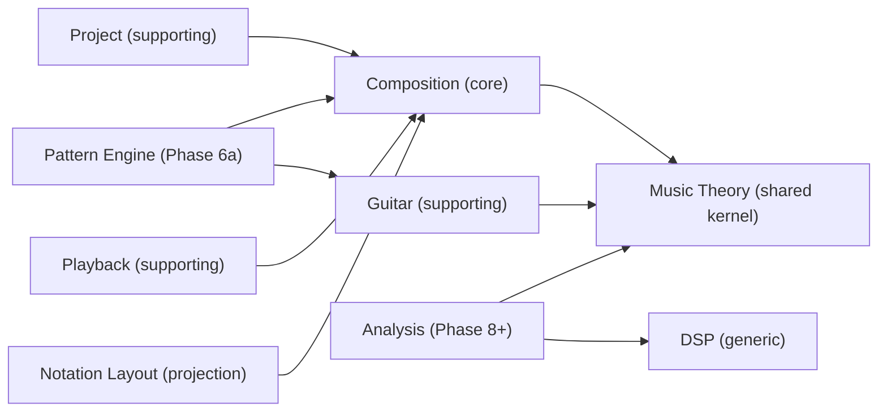

# Domain Map

Purpose: Show the bounded contexts, their classification, and the relationships between them.
Status: Accepted for MVP contexts. Analysis and Pattern contexts are Proposed.
Related documents: [bounded-contexts.md](bounded-contexts.md), [architecture-overview.md](architecture-overview.md), [ADR-003](decisions/ADR-003-context-map-and-crate-dag.md), [ADR-019](decisions/ADR-019-fretted-instrument-shared-kernel.md).

## 1. Contexts

| Context | Crate | Type | MVP | One-line responsibility |
|---|---|---|---|---|
| Music Theory | `mc-theory` | Shared kernel | Yes | Pitch, interval, scale and chord formulas, key, rational duration, fretted-instrument value objects |
| Composition | `mc-score` | Core domain | Yes | The Score aggregate and its invariants |
| Guitar | `mc-guitar` | Supporting | Yes | Fretboard queries, chord finder, voicings, scale positions, CAGED, later fingering |
| Pattern Engine | `mc-pattern` | Supporting | No (Phase 6a) | Pattern IR, validation, binding to a voicing |
| Project | `mc-project` | Supporting | Yes | Native package format, DTOs, migrations, integrity |
| Playback | `mc-playback` | Supporting | Yes | Score to PerformanceTimeline, MIDI mapping |
| Notation Layout | `mc-notation` | Generic projection | TAB only | Read model: layout display lists |
| DSP | `mc-dsp` | Generic | Yes (tuner) | Pure signal algorithms |
| Analysis (Music Intelligence) | not created yet | Supporting | No (Phase 8+) | Candidates with provenance |

Application layer (`mc-app`) and adapters (`mc-audio`, `mc-ffi`, `mc-cli`) are not domain contexts. See [architecture-overview.md](architecture-overview.md).

## 2. Context map

Arrows point from the downstream (dependent) context to the upstream context it depends on.

Relationship types:

- Composition, Guitar and Analysis share the Music Theory kernel. Changes to the kernel are reviewed as shared-kernel changes (GR-13).
- Project, Playback and Notation are conformist downstream contexts of Composition: they read the Score model as published.
- Pattern Engine is a customer of both Guitar (voicings) and Composition (it emits score fragments that the application layer applies as commands).
- Analysis never depends on Composition mutation APIs. It produces candidates; the application layer turns accepted candidates into score commands (GR-04, ADR-013).
- DSP has no domain dependency at all.

## 3. Rejected or merged contexts

| Hypothesis | Decision | Reason |
|---|---|---|
| Notation as bounded context | Merged into a projection crate | It has no aggregates or invariants of its own. It is a view of the Score |
| Audio as bounded context | Split into `mc-dsp` (pure) and `mc-audio` (adapter) | Audio is a technical capability, not a domain language |
| Workspace or Application context | UI state in Flutter | Panel layout and preferences carry no music rules |
| Separate Instrument context | Not now | Too small. Fretted-instrument value objects live in the shared kernel ([ADR-019](decisions/ADR-019-fretted-instrument-shared-kernel.md)). Extraction target `mc-instrument` if triggers occur |
| Separate Tuner context | Part of DSP plus a Guitar tuning query | Tuner is pitch detection compared with a Tuning |
