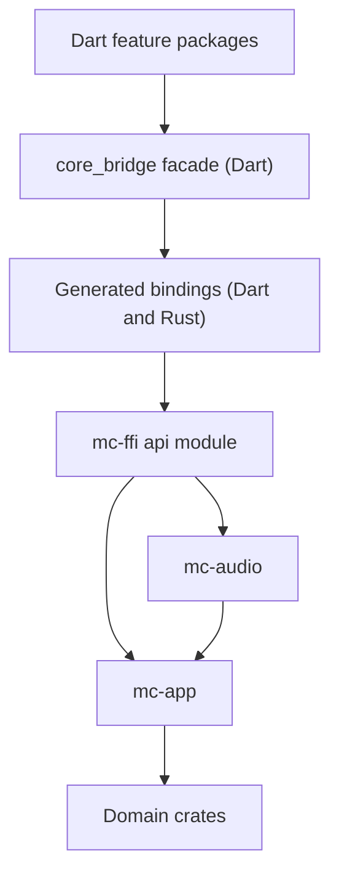
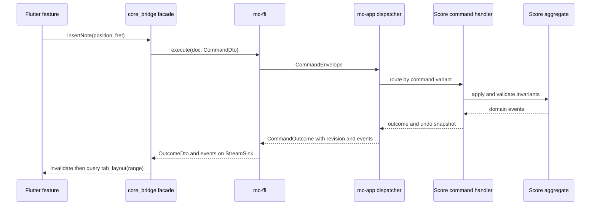
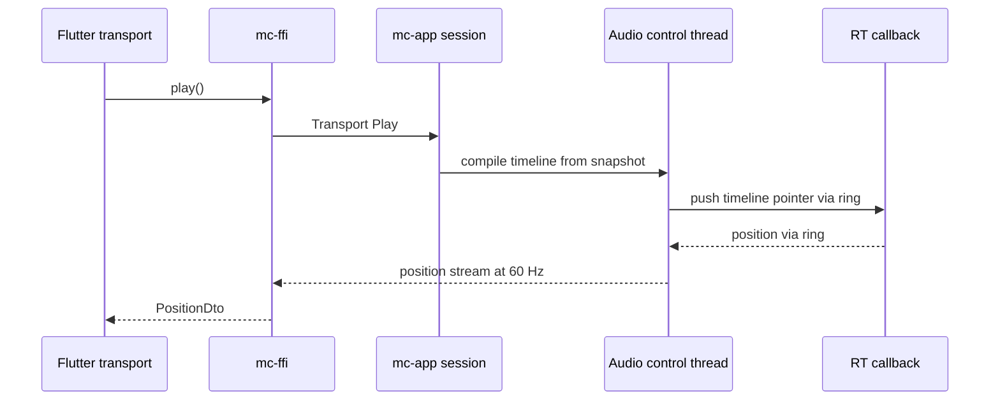

# Dart and Rust Interop Architecture

Purpose: Define how the Flutter app and the Rust Music Core communicate: transport, API surface, commands, queries, events, high-frequency streams, serialization, versioning, contract tests and benchmarks.
Status: Accepted (approach B), validated by S1 on Windows with the amendments in [ADR-005](decisions/ADR-005-dart-rust-interop-frb.md). Sync vs async `tab_layout`: sync is acceptable for TAB (S4: about 50 µs per system including FFI).
Related documents: [architecture-overview.md](architecture-overview.md), [score-model-and-undo.md](score-model-and-undo.md), [audio-dsp-architecture.md](audio-dsp-architecture.md), [ADR-005](decisions/ADR-005-dart-rust-interop-frb.md), [ADR-006](decisions/ADR-006-event-model.md), [technical-spikes.md](../research/technical-spikes.md).

## 1. Alternatives

| Criterion | A. Direct typed frb calls only | B. Typed frb commands and queries + typed event streams | C. Protobuf messages over FFI | D. Protobuf or gRPC IPC |
|---|---|---|---|---|
| Runtime overhead | Low | Low (frb codec, SSE) | Medium: encode plus frb or raw byte copy | High: process hop, socket, encode |
| Type safety | Generated | Generated, end to end | Generated from .proto; domain mapping manual | Same as C |
| Schema evolution | Not needed (same binary) | Not needed (same binary) | Strong, but benefit is unused in a single binary | Needed and useful |
| Codegen and build | frb only | frb only | frb or raw FFI plus protoc for Rust and Dart | protoc, gRPC stack, process packaging |
| Push notifications | Polling | Streams | Hand-built | Native streaming |
| Debugging | Good | Good | Opaque bytes | Separate processes, good tooling |
| Cross-platform | frb platforms | frb platforms | Same | Mobile and Web IPC problematic |
| WASM | frb Web [To verify] | frb Web [To verify] | Possible | Not in browser |
| Maintainability | Good, but UI polls | Good | Two schemas to maintain | Highest cost |
| Verdict | Rejected | Recommended | Rejected | Deferred |

Why not Protobuf now: Dart and Rust ship in one binary and are always built together, so the transport contract never needs cross-version compatibility. Protobuf would add a second schema language, a second code generator, and an encode step, and still require mapping into domain types. Persisted data has its own versioned DTOs (see [project-format.md](project-format.md)).

Triggers for D (or Protobuf): out-of-process ML or Python sidecar, a plugin ABI, a remote API, or a third-party SDK binding in another language that cannot use frb.

## 2. Layers and responsibilities

| Layer | Location | Responsibility | Must not |
|---|---|---|---|
| Generated bindings | `packages/core_bridge/lib/src/generated`, `mc-ffi` generated module | Transport and marshalling | Contain hand-written logic |
| Rust API surface | `mc-ffi/src/api/` | frb-exposed functions, opaque handles, DTO and error mapping, stream registration, composition root wiring adapters into `mc-app` | Contain musical rules |
| Application layer | `mc-app` | Document sessions, dispatcher, command handlers grouped by context module, undo, event publication via `EventSink` port, queries | Depend on frb, Dart or FFI types |
| Domain | `mc-score`, `mc-guitar`, ... | Aggregate methods returning `Result<Vec<DomainEvent>, DomainError>` | Publish events, know about sessions |
| Dart facade | `core_bridge` public API | `DocumentService`, `AudioService`, `ToolsService` Dart interfaces wrapping generated calls; fakes for tests | Hold domain state |

## 3. Command dispatching without a God Object

```rust
// mc-app (no FFI types)
pub enum Command {
    Score(ScoreCommand),       // handled by mc-app::score_handlers
    Track(TrackCommand),       // mc-app::track_handlers
    Transport(TransportCommand), // mc-app::transport_handlers (audio port)
    Guitar(GuitarCommand),     // mc-app::guitar_handlers (e.g. retune)
}

pub struct CommandEnvelope {
    pub id: CommandId,
    pub expected_revision: Option<Revision>,
    pub command: Command,
}

pub struct CommandOutcome {
    pub revision: Revision,
    pub events: Vec<EventEnvelope>,
}

impl DocumentSession {
    pub fn execute(&mut self, env: CommandEnvelope) -> Result<CommandOutcome, CommandError> {
        self.check_revision(env.expected_revision)?;
        let before = self.score.clone();             // structural-sharing snapshot
        let events = match env.command {             // routing only
            Command::Score(c) => score_handlers::handle(&mut self.score, c)?,
            Command::Track(c) => track_handlers::handle(&mut self.score, c)?,
            Command::Guitar(c) => guitar_handlers::handle(&mut self.score, c)?,
            Command::Transport(c) => return transport_handlers::handle(&self.audio, c),
        };
        self.commit(before, env.id, events)          // undo push, revision++, publish
    }
}
```

- The dispatcher is an exhaustive `match`: adding a command variant fails compilation until it is routed. No registry, no reflection, no dynamic handler lookup.
- Each handler module owns its context's commands. Handlers call aggregate methods; they do not reach into other handlers.
- A failed command leaves score and revision unchanged (the snapshot is discarded).
- Commands are serialized per document (single writer). Different documents are independent.
- Queries are plain functions on a snapshot: `tab_layout(&score, track, range, metrics)`. They never mutate.

## 4. Events

### Taxonomy

| Kind | Producer | Examples | Transport |
|---|---|---|---|
| Domain event | Aggregate methods (returned values) | `BarContentChanged { track, bar_range }`, `TrackAdded`, `TempoMapChanged` | Document event stream |
| Application event | `mc-app` | `DocumentSaved`, `DocumentDirtyChanged`, `UndoAvailabilityChanged`, `PlaybackStateChanged`, `JobProgress`, `RecoveryAvailable` | Document or engine event stream |
| Telemetry | Anything | timings, warnings | `tracing` spans and logs, not events |

### Envelope

```rust
pub struct EventEnvelope {
    pub seq: u64,                 // per document, gapless, starts at 1 on open
    pub document_id: DocumentId,
    pub revision: Revision,       // revision after the command
    pub correlation_id: CommandId,// command that caused it
    pub causation: Option<EventId>, // always None in MVP; kept for jobs and follow-up events later
    pub payload: EventPayload,
}
```

### Semantics

- Order: total per document (single writer). No ordering guarantee across documents or between document and engine streams.
- Events are invalidation hints. Payloads carry ids and ranges, not content. Dart re-queries projections, so music data is not duplicated in Dart.
- Resync: if Dart detects a gap in `seq` or a revision older than one it has seen, it discards caches and issues a full resync query (`document_summary` plus visible layout).
- Errors: command errors are returned as typed `Result` values, never as events.
- Lifecycle (revised after S1): a stream is created by `document_events(handle, sink)` and is owned by Rust. It ends when Dart calls an explicit `unsubscribe_events(handle)` or when the document handle is closed or dropped; Rust then drops the sink, which completes the Dart stream. Cancelling the Dart subscription alone does not release the Rust sink, and awaiting that cancel did not complete in S1. At most one subscriber per document stream; Dart fans out locally.
- No global event bus. Each document session and the audio engine expose their own streams.
- Backpressure: the document stream is low-rate (one batch per command). If the sink fails (Dart side gone), the session drops the sink and logs.

## 5. High-frequency streams (separate from events)

| Stream | Rate | Payload | Source |
|---|---|---|---|
| Playback position | 30 to 60 Hz (UI frame aligned) | tick, bar, beat, playing flag | Audio control thread, coalesced latest-value |
| Tuner reading | 20 to 30 Hz | Hz, nearest note, cents, clarity | Tuner thread, coalesced |
| Meters (later) | 30 Hz | peak, RMS per channel | Audio control thread |

Rules: latest-value semantics (drop intermediate values, never queue unboundedly); no audio samples cross FFI; RT threads never call frb directly; the Dart playback cursor extrapolates from tempo between updates so a single late update does not stall it (S1 saw one 56 ms gap in 10 minutes at 60 Hz). Numeric fields use types that map to Dart `int`; Rust `u64` maps to `BigInt` (S1). Waveform or spectrogram views (later) receive pre-reduced data (min/max per pixel column), requested as queries.

## 6. API sketches

Rust (`mc-ffi`):

```rust
#[frb(opaque)]
pub struct DocumentHandle(Arc<Mutex<DocumentSession>>); // mutex held only by the command worker path, never by RT threads

pub async fn open_document(bytes: Vec<u8>) -> Result<OpenResultDto, ApiError>;
pub async fn new_document(template: TemplateDto) -> Result<DocumentHandle, ApiError>;
pub async fn execute(doc: &DocumentHandle, cmd: CommandDto) -> Result<OutcomeDto, ApiError>;
pub async fn undo(doc: &DocumentHandle) -> Result<OutcomeDto, ApiError>;
pub fn tab_layout(doc: &DocumentHandle, track: TrackIdDto, range: BarRangeDto, metrics: MetricsDto) -> TabLayoutDto;
pub fn document_events(doc: &DocumentHandle, sink: StreamSink<EventDto>);
pub fn playback_position(engine: &EngineHandle, sink: StreamSink<PositionDto>);
pub fn find_voicings(chord: ChordSymbolDto, tuning: TuningDto, constraints: VoicingConstraintsDto) -> Vec<VoicingDto>;
```

Dart facade (`core_bridge`):

```dart
abstract interface class DocumentService {
  Future<Outcome> execute(Command command);
  Future<Outcome> undo();
  Stream<DocEvent> events();
  TabLayout tabLayout(TrackId track, BarRange range, LayoutMetrics metrics);
}
// FakeDocumentService implements DocumentService for widget tests.
```

Whether `tab_layout` is sync or async is decided in S1/S4: sync is simpler for painting but must stay under the frame budget.

## 7. DTO policy

- Commands and projections are application-layer types defined in `mc-app`. They are not domain types.
- Where shapes match, `mc-ffi` exposes them through frb mirroring (`#[frb(mirror)]`) so no duplicate struct is written. S1 checks that mirroring works without frb annotations inside `mc-app` [To verify].
- Dedicated DTOs only where shapes differ (for example ids as integers, rationals as numerator and denominator pairs).
- Persisted format DTOs (in `mc-project`) are separate because they need schema evolution. That is the only justified second representation.
- No Protobuf, no JSON over FFI.

## 8. Dependency view



## 9. Command flow



## 10. Event and playback flow



## 11. Versioning and compatibility

| Contract | Compatibility need | Policy |
|---|---|---|
| frb transport (Dart and Rust) | None across versions: built together | Regenerate on every change; CI fails if generated code is stale (FF-12) |
| Persisted project format | Strong | See [project-format.md](project-format.md) |
| Preferences JSON | Moderate | Unknown fields ignored; defaults on missing |
| Future public SDK API (Phase 11) | Semver | cargo-semver-checks |
| Future remote or plugin API | Strong | Decide schema technology then (Protobuf candidate) |

## 12. Contract tests

- FF-12: CI runs frb codegen and `git diff --exit-code` on generated files.
- Dart integration tests (`integration_test`) against the real Rust library on Windows: open, execute, undo, events order, resync on gap, stream cancellation.
- Rust tests of `mc-ffi` mapping: DTO round trip for every command variant (property test with generated commands).
- Widget tests use `FakeDocumentService`; a shared contract test suite runs against both the fake and the real implementation so the fake cannot drift.

## 13. Benchmarks (S1, then CI from Phase 3)

| Benchmark | Metric | Provisional target | Rationale |
|---|---|---|---|
| execute round trip (no-op command) | p50, p99 | p99 under 2 ms | Leaves most of a 16 ms frame for layout and paint |
| execute + tab_layout of 8 visible bars | p99 | under 16 ms on reference score | 60 fps feedback |
| tab_layout payload | bytes, conversion time | measure, then set | Unknown until S4 |
| position stream | sustained rate, max delivery gap, gaps over 50 ms per 10 min (measured at the Dart listener) | 60 Hz without UI jank; S1 baseline: 59.99999 Hz, max gap 56 ms, 1 gap over 50 ms | Smooth cursor; monitored, not a real-time audio path |
| open typical project | wall time | under 500 ms | Perceived instant open |

Targets are provisional until measured ([performance-requirements.md](performance-requirements.md)).

## 14. Decide now vs defer

| Decide now | Defer (trigger) |
|---|---|
| frb v2 as transport | IPC or Protobuf (sidecar process, plugin ABI, remote API) |
| Typed commands, exhaustive dispatcher | Rust-to-Dart callbacks (a concrete need such as Dart-provided text metrics during layout) |
| Event envelope and invalidation semantics | Command batching or transactions across documents (multi-document features) |
| Control-plane and data-plane split | Plugin ABI (plugin ADR-017 trigger) |
| No domain model in Dart | Remote API (cloud phase) |
| Sync vs async `tab_layout` | Decided in S1/S4 |

## 15. Incremental interop roadmap

1. Phase 0 (S1): prove opaque handle, async execute, event stream, 60 Hz stream, mirroring, Windows build.
2. Phase 3: `mc-ffi` with document lifecycle, execute, undo, tab_layout, events; `core_bridge` facade and fake; FF-12.
3. Phase 4: engine handle, transport commands, position stream.
4. Phase 5: tuner stream, chord finder queries.
5. Later: job progress events for long-running analysis (Phase 8+).
