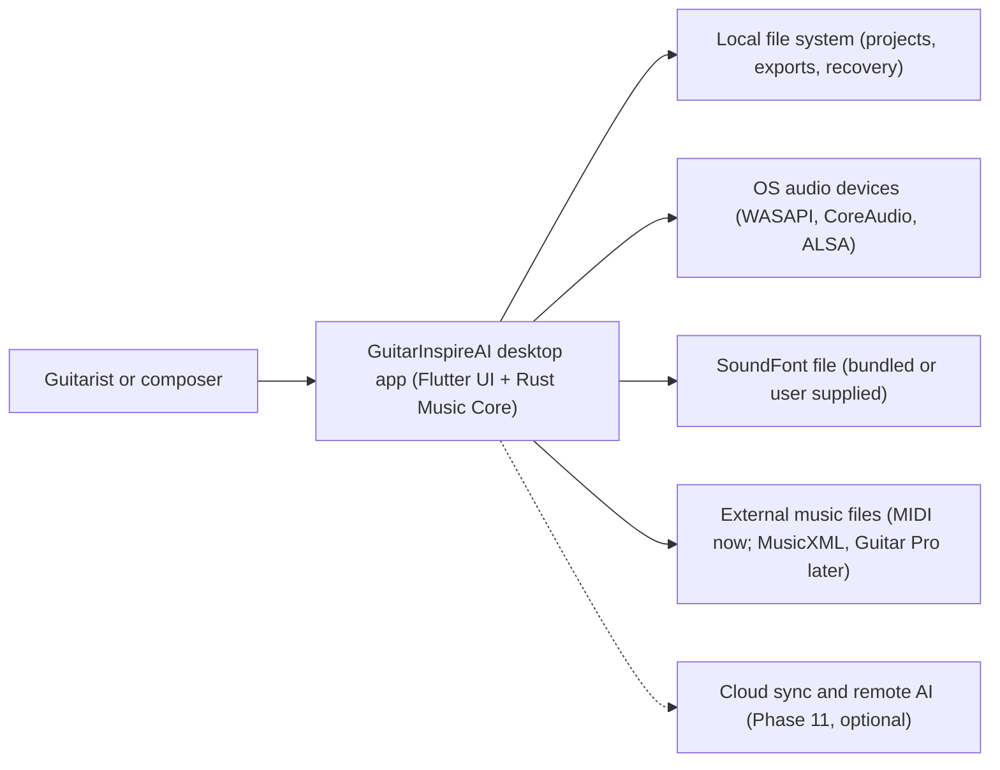

# System Context

Purpose: Define the system boundary, actors and external systems, and what is explicitly out of scope.
Status: Accepted for MVP scope.
Related documents: [architecture-overview.md](architecture-overview.md), [security-and-privacy.md](security-and-privacy.md), [roadmap/README.md](../roadmap/README.md).

## 1. Context diagram

## 2. Actors

| Actor | Goals |
|---|---|
| Guitarist (learner or player) | Tune, find chords, view and play TAB |
| Composer or arranger | Write and edit multi-track TAB, play back, save, export MIDI |
| Developer (future SDK and CLI user) | Use the Music Core from Rust tools (Phase 11) |

## 3. External systems

| System | MVP | Interaction | Trust |
|---|---|---|---|
| File system | Yes | Read and write projects, autosave, exports | Files are untrusted input |
| Audio output | Yes | Playback via cpal | Device errors expected (unplugged, busy) |
| Audio input (microphone) | Yes | Tuner | Requires OS permission |
| SoundFont | Yes | Load at startup or on change | Untrusted file; parsed by rustysynth |
| MIDI files | Yes (import and export) | Adapter | Untrusted input |
| MusicXML, Guitar Pro, PDF | No | Phase 6 adapters | Untrusted input |
| MIDI devices (live input or output) | No | Deferred | |
| Network | No | None in MVP ([ADR-010](decisions/ADR-010-local-first.md)) | |

## 4. Out of scope for MVP

Standard notation, PDF, Guitar Pro import, pattern engine, vocal analysis, transcription, AI arrangement, mobile builds, Web build, cloud, plugins, live MIDI devices, audio tracks.
