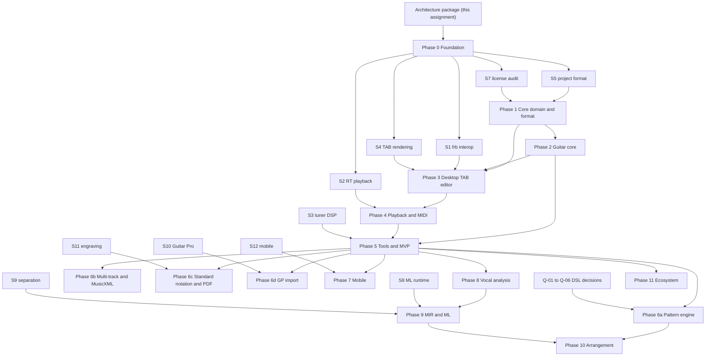

# Dependency Map

Purpose: Show dependencies between phases, spikes and user decisions.
Status: Proposed.
Related documents: [implementation-phases.md](implementation-phases.md), [technical-spikes.md](../research/technical-spikes.md), [open-questions.md](../research/open-questions.md), [milestones.md](milestones.md).

Arrows point from a prerequisite to the work it unblocks.

Critical path to MVP: Phase 0 (S1, S4, S5) to Phase 1 to Phase 3 to Phase 4 to Phase 5. Phase 2 can run in parallel with early Phase 3 work in principle, but a solo developer executes sequentially; the estimates assume sequential work.
